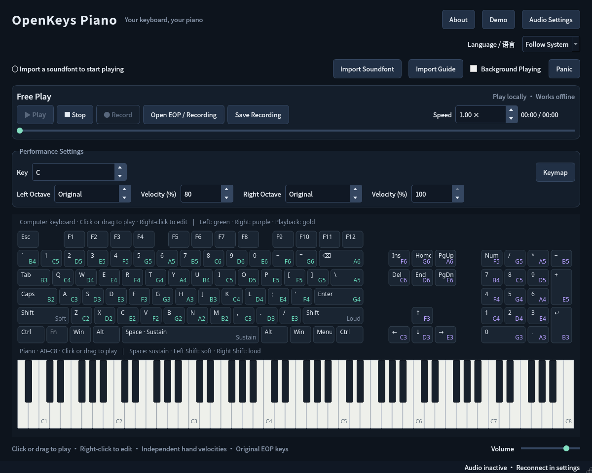

# OpenKeys Piano

[简体中文](README.zh-CN.md)

Free and open-source computer-keyboard piano. The first release targets Windows x64 and uses C++20, Qt 6 Widgets, FluidSynth and PortAudio. Linux supports development and automated verification.

Play with both hands, view all 88 piano keys, edit key mappings, use sustain and velocity modifiers, play EOP files, record performances and play in the background on Windows.



## Download

Version 0.1.1 is available from [GitHub Releases](https://github.com/YEWPO/OPK/releases/tag/v0.1.1) as a Windows x64 NSIS installer or portable ZIP, together with SHA-256 checksums. The installer and executables are not code-signed. Windows file properties and the installed-app list identify OpenKeysPiano, but security prompts may still show an unknown publisher or SmartScreen warning. No soundfont is bundled; import your own SF2 after installation. Linux is source-only in this release; see [Build and Packaging](docs/build.md).

## First use: import a soundfont

**No soundfont is bundled or automatically downloaded.** Choose **Import Soundfont**, select your own extracted `.sf2` file, and wait for copying and loading to finish.

The application saves a managed copy and reloads it next time. After a successful import, you may remove the original download. A replacement is committed only after loading succeeds; failures preserve the previous soundfont and settings.

Without a soundfont, you can edit key mappings and open performance files. Playing audio and recording become available after importing a soundfont and starting an audio device.

See the [Soundfont Import Guide](docs/soundfont.md) for download links, extraction, import and troubleshooting. **Import Guide** opens the same embedded content offline.

## Language

The application and Windows installer support English and Simplified Chinese. On first use, Chinese systems select Simplified Chinese; other systems select English. An installation uses its selected language as the application's initial preference. Existing application preferences take priority.

Use **Language / 语言** to select **Follow System**, **English** or **简体中文**. The saved choice takes effect after restarting. The uninstaller uses the installation language. Portable builds follow the system until you choose a preference. `--language system|en|zh_CN` overrides the current process without saving a preference.

## Playing and recording

- Left hand: `Z X C V B N M` starts at C2, `A S D F G H J` at C3, `Q W E R T Y U` at C4, and the number row at C5. Subsequent keys continue upward.
- Right hand: numeric keypad `1 2 3 4 5 6 7 8 9` plays white keys upward from C4. Arrow and navigation keys extend the range.
- Hand velocities display 0–100%; 100% corresponds to MIDI velocity 127, and 0% produces no new notes. Playback values are displayed as percentages without changing recorded MIDI data.
- Click or drag the playback bar to seek. Dragging previews the position; releasing seeks while preserving play/pause state.
- The computer-keyboard view uses a fixed full-size layout, with double-height keypad `+` and Enter keys. The bottom row includes Fn, left/right Win and Menu. Fn is decorative and cannot be played or edited. Win and Menu are unassigned by default. Physical layouts may differ.
- Hold `Space` for sustain; left `Shift` plays softly, right `Shift` loudly. Ordinary computer keyboards do not sense key velocity; these modifiers adjust MIDI velocity.
- Click or drag across either on-screen keyboard to play. Release or drag into empty space to silence the mouse note. The mouse plays one key at a time and can accompany physical keys. Visual feedback also works without a soundfont.
- Right-click a computer key to choose a note name, octave, accidental, hand, sustain or unassigned state. C4 is middle C. **Keymap** imports, exports or restores layouts. Every startup restores C, original hand octaves and 80%/100% left/right velocities while preserving custom bindings; explicitly imported profiles apply their own settings.
- **Key**, **Left Octave** and **Right Octave** affect subsequent live notes only; playback retains file pitches. Key names use C, Db, D, Eb, etc., with octave annotations when needed. Main performance and speed controls use their up/down buttons, including press-and-hold; typing, arrow keys and the mouse wheel do not change them.
- **Open EOP / Recording** supports `.eop` and `.eopiano.json`, with play, pause, stop and speed adjustment. EOP playback uses the file's pitches and physical keys.
- **Record → Finish Recording → Save Recording** saves performance events, not microphone audio. Open the recording again to replay it. Choose **Demo**, then **Play**, to try the included original performance.
- Windows **Background Playing** is off by default. Enable it to play while viewing another window; ordinary keystrokes still reach the foreground application. `Ctrl+Alt+F12` or **Panic** silences all notes and disables background playing. An occupied shortcut prevents background mode from being enabled.

Text entry, dialogs and suspension of foreground playing release held notes. Resolve hardware key rollover limits by changing bindings or using a keyboard with better simultaneous-key support.

Audio Settings provides device selection, 64–2048-frame buffers and WASAPI exclusive mode, with a visible fallback to shared mode. Reopen settings to reconnect a device. Reported buffer latency comes from the driver and is not measured key-to-sound latency.

## Build and package

With Linux development dependencies installed:

```sh
cmake -S . -B build -G Ninja -DCMAKE_BUILD_TYPE=Debug
cmake --build build --parallel 4
ctest --test-dir build --output-on-failure
./build/openkeys
```

If your environment uses a read-only ccache, configure with `-DCMAKE_CXX_COMPILER=/usr/bin/g++`.

Windows requires Visual Studio 2022 C++ tools, CMake and vcpkg; installers also require NSIS:

```powershell
$env:VCPKG_ROOT = 'C:/dev/vcpkg'
cmake --preset windows-release
cmake --build --preset windows-release --parallel 4
ctest --preset windows-release
./tools/package_windows.ps1
```

Building and packaging require no soundfont. Packages contain both offline guides and example performance data, without SF2/SF3 files. See [Build and Packaging](docs/build.md).

The installer enables desktop and Start Menu shortcuts by default; either can be deselected. It does not modify PATH. The application, shortcuts, installer and uninstaller share a one-octave piano icon: the OKP wordmark above seven white keys and five black keys in two-plus-three groups. Uninstall removes shortcuts and the entire installation directory, including files placed there by the user; data outside that directory is preserved.

## Validation and limitations

Automated tests cover managed soundfont import, persistence, duplicate import, failure/cancellation recovery, replacement, offline guides, languages, recording, keymaps, sampler rendering and EOP parsing. Generated soundfont fixtures do not certify any third-party piano's sound quality.

Use `openkeys-soundfont-check` to produce SF2 reports and audition WAV files. `OPENKEYS_TEST_SOUNDFONT` enables optional integration tests; without a user-supplied bank they are explicitly skipped. See [Validation](docs/validation.md).

Windows Raw Input, WASAPI, interactive Windows 10/11 installation, DPI and end-to-end latency still require real-machine acceptance. Actual EOP libraries have not been compared song by song with the original application. External MIDI input, VST hosting, EOP export, practice scoring and score engraving are outside this first release. See [EOP Compatibility](docs/eop-compatibility.md).

Source code is GPL-3.0-or-later; see [LICENSE](LICENSE) and [Third-party Notices](THIRD_PARTY_NOTICES.md). Users obtain and import third-party soundfonts themselves.
